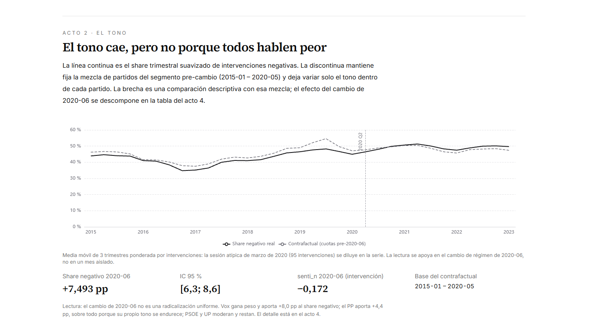
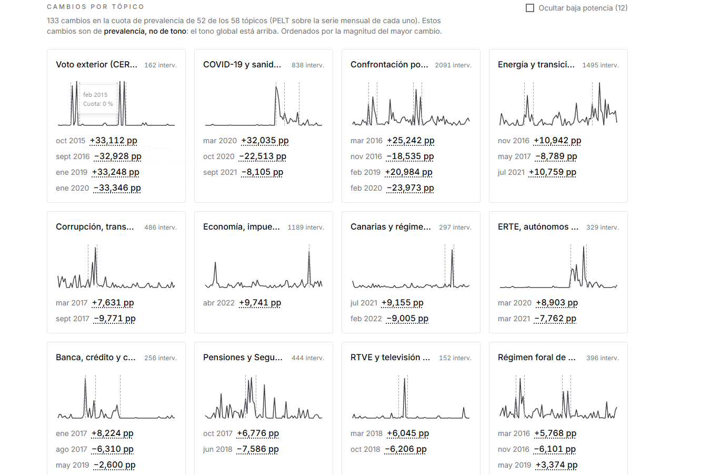

# hemiciclo-nlp

**Thematic and tonal evolution of the Spanish Congress of Deputies (2015–2023), with detection of regime changes linked to political events.**

A complete NLP pipeline over the public **ParlaMint-ES** corpus: 30,018 cleaned parliamentary speeches are embedded, clustered into 58 topics, tracked as monthly series, and analysed for regime changes with statistically validated changepoint detection. Results are served through an interactive dashboard.



## Key findings

- **58 interpretable topics** identified with BERTopic, selected from a 36-configuration grid (coherence 0.75, diversity 0.94). The topic structure is **robust to the embedding model**: re-running the pipeline with bge-m3 instead of multilingual-e5-large reproduces the clustering (NMI 0.88, ARI 0.71 over 15,233 comparable speeches).
- **One robust tone regime change.** Of the three candidate changepoints in the monthly tone series, only **June 2020** survives multiple-testing correction (mean shift −0.20, Mann-Whitney r = −0.62, BH-adjusted q ≈ 10⁻⁴): a sustained drop in parliamentary tone coinciding with the COVID-19 period.
- **Topic-level regime changes are rare and dated.** Only a minority of the PELT candidates survive Benjamini-Hochberg correction. Survivors include *Energy and energy transition* (Nov 2016, Jul 2021), *COVID economic measures, ERTE and tourism* (Mar 2020), *Pensions* (Jun 2018) and *Corruption and transparency* (Sep 2017).
- **Event associations remain exploratory.** None of the Spearman correlations between curated political events (general elections, the 2020 investiture, the COVID state of alarm, the war in Ukraine) and the topic/tone series survives multiple-testing correction. They are reported as exploratory, never causal.
- **Sentiment validation.** ParlaCAP sentiment annotations were checked against 77 stratified, hand-annotated interventions: 66% accuracy on the 3-band scale, quadratic κ = 0.66 (95% bootstrap CI 0.50–0.78). On the 6-band scale exact-class accuracy is low (36%) but ordinal agreement remains high (quadratic κ = 0.70).

## Dashboard

All results are explorable through an interactive four-section panel (topics, tone, regime changes and event contrasts). The topic-level view tracks every monthly series and its candidate regime changes:



## Method

| Stage | What it does |
| --- | --- |
| Corpus | ParlaMint-ES 5.0 (2015-01-01 → 2023-02-23), 76,369 plenary interventions; presidency turns dropped (57%), regex cleaning of courtesies and formulas → 30,018 speeches |
| Representation | multilingual-e5-large embeddings (1024-d); token windows of 384 with stride 320 (64-token overlap); chunk mean, L2 renormalized |
| Topics | BERTopic (UMAP → HDBSCAN → c-TF-IDF); 36-cell hyperparameter grid chosen by coherence/diversity; topic labels LLM-proposed, human-reviewed |
| Sentiment | ParlaCAP ParlaSent annotations; human validation on 77 stratified interventions (3/6 bands, quadratic kappa with bootstrap CIs) |
| Regime changes | PELT (l2 cost, BIC-selected penalty) on monthly topic shares and mean tone; candidate changes tested with Mann-Whitney U and Benjamini-Hochberg correction |
| Events | Curated CSV of political events; Spearman associations with multiple-testing correction |
| Product | API + Next.js dashboard, Docker Compose, pytest / Vitest / Playwright, WCAG AA accessibility audits |

Full phase-by-phase specification: `docs/PROJECT_SPEC.md`. Technical decision log: `docs/DECISIONS.md`. Data sources and download commands: `docs/SOURCES.md`. All result tables: `reports/tables/`. Folder contract: `structure.md`.

## Environment

- Python 3.12 managed with `uv`.
- The base install (`uv sync`) includes only core and dev tools. Heavy dependencies are grouped by phase:

```bash
uv sync                 # core + dev (pytest, ruff, pyright, pre-commit)
uv sync --extra corpus  # Phase 1
uv sync --extra nlp --extra analysis  # Phases 3a and 3b
uv sync --all-extras    # everything
```

- Local hooks: `uv run pre-commit install` (once). Checks: `uv run pytest`, `uv run pre-commit run --all-files`.
- Tests that download or run models are marked `heavy` and skipped by default; they only run with `HEMICICLO_HEAVY=1` on a capable machine (D-30).
- Heavy runs (embeddings, BERTopic) are executed on the NVIDIA machine, which clones the repo, downloads the corpus and runs; git only transports code and `reports/` (D-27).

## Local product

Requirements: Python 3.12 with `uv` and **Node 20.9+ with npm** (the dashboard lives in `frontend/`).

### Development

```bash
npm run dev:all   # from the repo root: API (:8000) + dashboard (:3000), single command
```

The dashboard opens at http://localhost:3000. Automated checks: `uv run pytest` (Python), `npm test` (Vitest unit tests) and `npm run e2e` (Playwright + axe WCAG AA; starts API and dashboard on its own).

### Docker

`docker compose up --build` starts the API at http://localhost:8000 and the dashboard at http://localhost:3000.

## Corpus and data provenance

The corpus is not generated by this project: it comes from two external research resources on the Spanish Parliament, both CC BY 4.0. The project only **downloads and transforms** the data; it never redistributes it. Downloads are reproducible and MD5-verified against the hashes published by each source.

| Resource | Identifier | Used for |
| --- | --- | --- |
| **ParlaMint 5.0 ES** (text and metadata of plenary interventions, 2015-01-01 – 2023-02-23) | handle `11356/2004` | Phase 1: download, parsing, consolidation |
| **ParlaCAP 1.0 ES** (ParlaSent sentiment and CAP topic annotations) | DOI `10.23669/1ZTELP` | Phase 3a: sentiment validation and topic comparison |

```bash
uv run python -m src.corpus.downloader   # download into data/raw/corpus (MD5-verified)
uv run python -m src.corpus.parser       # consolidate into data/processed/intervenciones.parquet
uv run python -m src.preprocessing.cleaner  # data/processed/intervenciones_limpias.parquet
```

Everything stays in `data/`, ignored by git. Exact URLs, MD5 hashes, model sources and the curated event list are in `docs/SOURCES.md`.

## Code generation transparency

Most of the code in this repository (Python modules in `src/`, frontend components and logic, configuration, tests and documentation) was **generated with LLM assistance** through AI agents, following the author's instructions.

There has been **human review and validation**: the author reviews results, contrasts technical decisions (recorded in `docs/DECISIONS.md`) and verifies the project with automated tests, accessibility audits and reproducibility checks (`uv run pytest`, `npm test`, `npm run e2e`, `pre-commit`). Despite this review, the code may contain errors; known limitations are documented in the specification and the decision log.

## License

The **code** is released under the MIT license. The **data** is not redistributed here: ParlaMint-ES 5.0 and ParlaCAP 1.0 ES belong to their authors and are used under CC BY 4.0; they can be obtained from the sources linked in "Corpus and data provenance" with `uv run python -m src.corpus.downloader`.